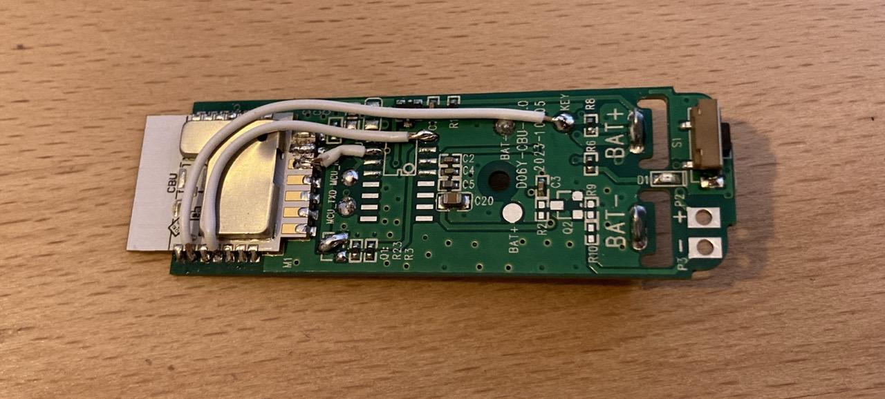

# tado window sensor

Custom firmware that turns a cheap Tuya Wi-Fi door/window contact sensor (the kind sold on AliExpress for a few euros) into a window sensor for **tado°** smart heating. When the window opens, the heating in the configured tado zone is switched off. When it closes, the zone goes back to its normal schedule.

The device talks to the tado API directly over Wi-Fi. It needs no Tuya cloud, no Home Assistant, and no bridge or server.

> [!NOTE]
> **This project was written by AI.** All code in this repository, including this README, was generated by [Claude Code](https://claude.com/claude-code) (Anthropic). A human set the direction, did the hardware work, and tested the result on real hardware. Review the code before you rely on it.

## Basic idea

Out of the box these sensors contain two chips:

- a **Tuya CBU Wi-Fi module** (Beken BK7231N), which connects to the Tuya cloud, and
- a small **TuyaMCU** microcontroller, which reads the reed switch, button, and LED. To save battery, the MCU uses a transistor to disconnect the Wi-Fi module's GND, and only powers the module up when there is something to report.

This project removes the TuyaMCU and its power-switching transistor, and connects the reed switch, button, and LED directly to the CBU module. The CBU then runs this firmware, built with [LibreTiny](https://github.com/libretiny-eu/libretiny) and PlatformIO, and does everything itself:

1. It spends almost all its time in **deep sleep** and wakes on a reed switch edge (GPIO wake) or on a timer.
2. After waking, it waits until the reed state has been stable for 2 s (debounce).
3. If the state differs from the last one tado accepted, it connects to Wi-Fi and calls the tado API:
   - **window open** (magnet gone): `PUT /overlay` sets heating OFF in manual mode with no timer.
   - **window closed** (magnet near): `DELETE /overlay` makes the zone follow its schedule again.
4. It goes back to sleep and arms the wake edge for the next change.

Other details:

- **Authentication** uses tado's OAuth2 device code flow. On first boot the device prints a login URL on the serial port. You approve it in a browser, and the refresh token is saved in flash. Once a day the device wakes on a timer to keep that token alive (tado refresh tokens expire after 30 days unused).
- **Fast reconnect:** the access point, channel, and IP configuration are cached, so most wakes skip the Wi-Fi scan and DHCP. If the cached connection fails, the device falls back to a full scan and DHCP.
- **Failed requests** are retried after 5 min, then with a doubling delay up to 1 h.
- **TLS** is verified against the Amazon/Starfield root CAs that tado uses ([include/root_ca.h](include/root_ca.h)). [platformio.ini](platformio.ini) enables ECDHE/GCM/SNI in the Beken SDK's mbedTLS, which tado's servers require.

### LED signals

| Pattern | Meaning |
|---|---|
| 1 short blink | State change detected, sending to tado |
| 1 more blink shortly after | tado accepted the change |
| Even blinking (2 Hz) for 60 s | Request failed, will retry |
| Double flash once per second for 60 s | A new tado login is needed (see [Logging in to tado](#4-log-in-to-tado)) |

## Building your own

### What you need

- A Tuya Wi-Fi door/window sensor with a **CBU module plus a separate TuyaMCU**. Open it up and check before you buy more.
- A soldering iron, thin wire, and a hot air station or desoldering braid (to remove the MCU and the transistor)
- A 3.3 V USB-UART adapter that breaks out **RTS**, for flashing and the first login
- [PlatformIO](https://platformio.org/) (CLI or VS Code extension)
- A tado account with a heating zone

### 1. Hardware modification

> [!WARNING]
> This is a permanent modification. The sensor will no longer work with the Tuya/Smart Life app.



1. Open the sensor and identify the CBU module, the TuyaMCU, the transistor in the CBU's GND path, and the traces from the MCU to the reed switch, button, and LED.
2. **Remove the TuyaMCU.**
3. **Remove the transistor and bridge its pads** so the CBU's GND pin is connected to GND all the time. Without the MCU nothing would switch the transistor on, and the CBU would never get power. The firmware saves power with deep sleep instead.
4. Rewire the three peripherals to the CBU module:

   | Peripheral | CBU pin | BK7231N GPIO | Wiring |
   |---|---|---|---|
   | Reed switch | 4 | P22 | Reed between the pin and GND. Uses the internal pull-up, so LOW means magnet near (window closed). |
   | Status LED | 12 | P24 | Active high: GPIO → resistor → LED → GND |
   | Push button | 2 | P16 | Button to GND, **external pull-up** required. Reads LOW while pressed. |

   The pins are defined in [include/config.h](include/config.h). Change them there if your board makes other pins easier to reach. The reed pin must be able to wake the chip from deep sleep (every CBU GPIO can).

5. Solder wires to the CBU's **TX1, RX1, CEN, and GND** pads for flashing and for the serial console. If your board has `MCU_TXD`/`MCU_RXD` test pads, you can use those for TX1/RX1 (see [the wiring note below](#3-test-the-wiring-then-flash)).

> [!TIP]
> The current firmware does not use the button for anything yet. It is wired up and checked by the hardware test mode, so it is ready for future features.

### 2. Configure

```sh
cp include/secrets.example.h include/secrets.h
```

In `include/secrets.h`, fill in:

- `WIFI_SSID` / `WIFI_PASS`: your 2.4 GHz network
- `TADO_HOME_ID`: from `GET https://my.tado.com/api/v2/me` → `homes[].id`
- `TADO_ZONE_ID`: from `GET https://my.tado.com/api/v2/homes/{homeId}/zones`. This is the zone whose heating is switched off.

`secrets.h` is in `.gitignore`.

You can adjust timing (debounce, retry delays, keepalive interval, LED patterns) in [include/config.h](include/config.h).

### 3. Test the wiring, then flash

Power the board **from its battery**, not from the USB-UART adapter. Connect only these four wires to the adapter:

| Adapter | CBU | Test pad on the sensor board |
|---|---|---|
| TX | RX1 | `MCU_TXD` |
| RX | TX1 | `MCU_RXD` |
| RTS | CEN | |
| GND | GND | |

> [!IMPORTANT]
> Some boards have test pads labelled `MCU_TXD` and `MCU_RXD`. These names describe the **TuyaMCU's** side of the UART, so they are already crossed relative to the CBU. Connect them straight through: `MCU_TXD` → adapter **TX** and `MCU_RXD` → adapter **RX**.

Leave the adapter's 3.3 V pin unconnected. In testing, flashing was much more reliable with battery power than with the adapter's 3.3 V supply. With RTS wired to CEN, PlatformIO (through LibreTiny's `ltchiptool`) resets the module into download mode by itself, so you don't have to short CEN to GND by hand.

Start with the hardware test. Set `APP_MODE` to `APP_MODE_HW_TEST` in [include/config.h](include/config.h), then:

```sh
pio run -t upload -t monitor
```

The LED should light while the magnet is near the reed switch, and reed and button changes are logged to the console. Once everything works, set `APP_MODE` back to `APP_MODE_SENSOR` and flash again.

There are two build environments:

| Environment | Command | Serial output |
|---|---|---|
| `cbu` (default) | `pio run -t upload` | Full diagnostic log at 115200 baud |
| `cbu_release` | `pio run -e cbu_release -t upload` | Silent, except for the tado login prompt |

### 4. Log in to tado

With the serial monitor open (`pio device monitor`), reset the device. On first boot it prints:

```
================ tado login required ================
Open this URL in a browser and approve the device:

    <verification URL with code>
...
```

Open the URL and approve the device within 5 minutes. The token is stored in flash and survives deep sleep, reboots, and reflashing.

The device only starts this login flow after a power-on or reset, never when it wakes from sleep. If the login is lost later (for example because the device was offline for more than 30 days), the LED shows the double-flash pattern. Reset the device with the serial monitor open to log in again.

### 5. Mount it

Remove the serial wires (or tuck them away), close the case, and mount the sensor and magnet on the window.

## Project layout

| File | Purpose |
|---|---|
| [src/main.cpp](src/main.cpp) | Sensor logic (debounce, apply, retry, deep sleep) and the hardware test mode |
| [src/tado.cpp](src/tado.cpp) | tado OAuth2 (device code flow, token refresh) and overlay API calls |
| [src/wifi_link.cpp](src/wifi_link.cpp) | Wi-Fi connect with cached AP/IP fast path |
| [src/storage.cpp](src/storage.cpp) | Persistent key-value storage in flash (tokens, last state, Wi-Fi cache) |
| [src/https.cpp](src/https.cpp), [src/tls_client.cpp](src/tls_client.cpp) | HTTPS client on mbedTLS with CA verification |
| [src/time_sync.cpp](src/time_sync.cpp) | SNTP, so stored access tokens can be reused across sleeps |
| [src/deep_sleep_fixup.c](src/deep_sleep_fixup.c) | Keeps the reed pin's pull-up during sleep (by default the SDK would apply a pull-down on rising-edge wake) |
| [src/mbedtls_fixup.c](src/mbedtls_fixup.c) | Provides a function missing from the Beken SDK's mbedTLS port |

## Limitations

- One sensor controls one tado zone. When the window closes, the zone resumes its schedule, which also removes any manual overlay you had set before opening it.
- Several sensors in the same zone are not coordinated: closing one window resumes the schedule even if another window in that zone is still open.
- This firmware uses tado's unofficial API, which can change or be rate-limited at any time.

## License

[MIT](LICENSE)

## Disclaimer

This project is not affiliated with tado GmbH or Tuya. Opening and modifying the device voids its warranty. Use at your own risk.
